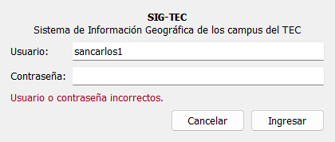
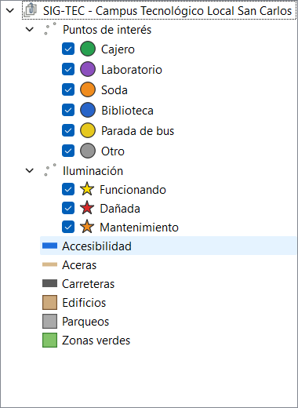
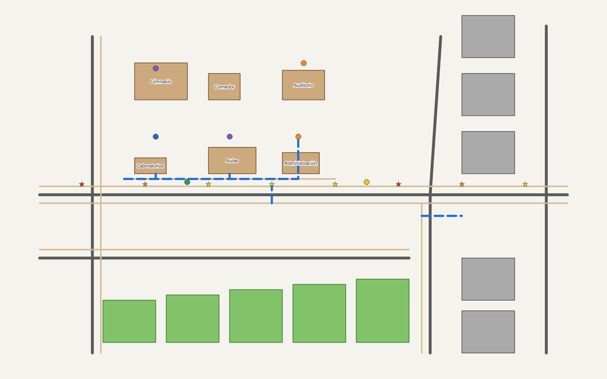
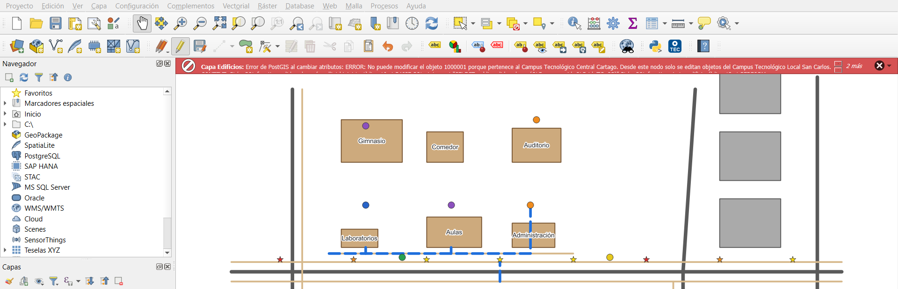

# SIG-TEC

**Sistema Distribuido de Gestión de Información Geográfica de los Campus del Tecnológico de Costa Rica**
Tercer Proyecto · Bases de Datos II · Instituto Tecnológico de Costa Rica, Sede San Carlos

Seis nodos PostgreSQL 17 + PostGIS 3.5 en Docker: un nodo central de autenticación y coordinación, y uno por campus (Cartago, San José, San Carlos, Alajuela y Limón). Cada campus edita solo sus datos y todos consultan todo. La información viaja con **replicación lógica en dos niveles**. QGIS es la interfaz y un **plugin PyQGIS** hace el ingreso.


---

## Prueba rápida

**Requisitos:** [Docker Desktop](https://www.docker.com/products/docker-desktop/) encendido, Python 3.10 o superior y git.

```powershell
git clone https://github.com/Danny7w7-coder/proyecto3Bases2.git sig-tec
cd sig-tec
pip install -r requirements.txt
python scripts/init_all.py --reset        # levanta los 6 nodos y deja todo listo (unos 2 min)
python scripts/correr_pruebas.py          # 54 pruebas automáticas: OK / FALLO
```

`init_all.py` hace todo: crea el archivo `.env` con **claves aleatorias** (no hay contraseñas en el repositorio), levanta los contenedores, crea las tablas, carga datos de ejemplo, arma la replicación y publica los estilos. Se puede correr varias veces sin romper nada. Con `--reset` borra todo y empieza de cero.

Las pruebas de `test_plugin_qgis` se omiten solas si QGIS no está instalado.

## Demostraciones

| Comando | Qué muestra |
|---|---|
| `python scripts/estado_nodos.py` | Los 6 nodos, versiones y configuración (WAL, 2PC) |
| `python scripts/replicacion.py estado` | Publicaciones y suscripciones de los dos niveles |
| `python scripts/verificar_consistencia.py` | Las 40 capas comparadas en los 6 nodos (conteo + hash) y el retraso de la replicación |
| `python scripts/demo_2pc.py` | Commit en dos fases entre el central y San Carlos: éxito, falla y caída del coordinador |
| `python scripts/modo_sincrono.py demo` | Replicación asíncrona contra síncrona, con el central arriba y caído *(apaga y enciende el central)* |
| `python scripts/escenarios.py a` | Borrado por error en San Carlos → recuperación PITR |
| `python scripts/escenarios.py b fisico` | Se pierde el nodo de Limón → respaldo físico + WAL |
| `python scripts/escenarios.py b desde_central` | Se pierde el nodo de Limón → recuperación con replicación lógica |

<details>
<summary>Más comandos</summary>

| Comando | Qué hace |
|---|---|
| `python scripts/replicacion.py reactivar` | Relanza suscripciones que quedaron sin proceso (por ejemplo tras reiniciar nodos) |
| `python scripts/replicacion.py resincronizar limon` | Reengancha un campus restaurado |
| `python scripts/respaldos.py logico todos` | `pg_dump` de cada nodo (base completa + esquema propio) |
| `python scripts/respaldos.py fisico todos` | `pg_basebackup` de cada nodo |
| `python scripts/respaldos.py verificar cartago` | Restaura el último `pg_dump` en una base aparte y compara |
| `python scripts/respaldos.py listar` | Respaldos guardados y estado del WAL archivado |
| `python scripts/restaurar.py pitr san_carlos "2026-11-24 20:11:23+00"` | PITR a una hora exacta (hora UTC del servidor) |
| `python scripts/simular_falla.py limon` | Borra el contenedor y el volumen de datos de un campus |
| `python scripts/generar_estilos.py listar` | Versiones de los estilos en el central |
| `python scripts/generar_estilos.py nueva edificios 70,130,200` | Nueva versión de un estilo (se replica a los campus) |
| `python scripts/generar_estilos.py activar edificios 1` | Vuelve a una versión anterior |
| `python scripts/cargar_datos.py --forzar` | Recarga los datos de ejemplo |

</details>

## Plugin de QGIS

1. Descargar **`sigtec.zip`** de la sección [Releases](../../releases/latest) (o generarlo con `python scripts/empaquetar_plugin.py` → `dist/sigtec.zip`).
2. En QGIS (3.22 o superior, probado en 3.44 LTR): **Complementos → Administrar e instalar complementos → Instalar a partir de ZIP**.
3. Botón **TEC** → ingresar con un usuario de ejemplo.

| Usuario | Campus | Clave |
|---|---|---|
| `cartago1`, `cartago2` | Cartago | `tec2026` |
| `sanjose1` | San José | `tec2026` |
| `sancarlos1`, `sancarlos2` | San Carlos | `tec2026` |
| `alajuela1` | Alajuela | `tec2026` |
| `limon1` | Limón | `tec2026` |
| `inactivo1` | San Carlos (inactivo, para probar el rechazo) | `tec2026` |

| Ingreso | Capas cargadas con sus estilos |
|---|---|
|  |  |



Editar un objeto de otro campus se rechaza en la base de datos (trigger `INSTEAD OF`) y QGIS muestra el motivo:



Detalle y prueba manual en 11 pasos: [docs/INSTALAR_PLUGIN.md](docs/INSTALAR_PLUGIN.md)

## Cómo está hecho

| Tema | Resumen | Detalle |
|---|---|---|
| Modelo | 5 esquemas por nodo (uno por campus) × 8 capas, SRID 5367 (CRTM05), id global por rangos, `CHECK` + trigger de dueño | [sql/comun/10_capas_por_esquema.sql](sql/comun/10_capas_por_esquema.sql) |
| Replicación | Nivel 1 campus → central. Nivel 2 central → los otros 4 campus + estilos | [docs/TRANSACCIONES.md](docs/TRANSACCIONES.md) |
| Vistas | `sig.<capa>` = `UNION ALL` de los 5 esquemas, con triggers `INSTEAD OF` | [sql/campus/31_vistas.sql](sql/campus/31_vistas.sql) |
| Autenticación | `usuarios` con bcrypt, `autenticar()` y un rol del plugin que solo puede llamarla | [sql/central/21_autenticacion.sql](sql/central/21_autenticacion.sql) |
| Estilos | `layer_styles` versionado en el central y replicado | [scripts/generar_estilos.py](scripts/generar_estilos.py) |
| Transacciones | Atomicidad, modo síncrono y 2PC | [docs/TRANSACCIONES.md](docs/TRANSACCIONES.md) |
| Respaldos | `pg_dump`, `pg_basebackup`, WAL, PITR y recuperación desde el central | [docs/RESPALDOS.md](docs/RESPALDOS.md) |

```
sig-tec/
├── docker-compose.yml     6 nodos (central + 5 campus), cada uno con volumen de datos y de WAL
├── .env.example           plantilla de configuración (el .env real se genera solo)
├── sql/                   scripts SQL en orden: central/, campus/ y comun/ (los 6 nodos)
├── scripts/               Python: instalación, replicación, demos, respaldos, recuperación
├── plugin/sigtec/         plugin PyQGIS
├── tests/                 pruebas automáticas (tests/qgis: dentro de QGIS)
└── docs/                  informe, guion del video, decisiones, checklist y figuras
```

## Documentación

| Archivo | Contenido |
|---|---|
| [docs/Informe_SIG-TEC.pdf](docs/Informe_SIG-TEC.pdf) | Informe del proyecto (también en [Word](docs/Informe_SIG-TEC.docx)) |
| [docs/INSTALAR_PLUGIN.md](docs/INSTALAR_PLUGIN.md) | Instalación y prueba del plugin en QGIS |
| [docs/TRANSACCIONES.md](docs/TRANSACCIONES.md) | Replicación en dos niveles, modo síncrono y commit en dos fases |
| [docs/RESPALDOS.md](docs/RESPALDOS.md) | Respaldos, PITR y escenarios de recuperación |

## Nodos

| Nodo | Contenedor | Puerto |
|---|---|---|
| central | sigtec_central | 5440 |
| cartago | sigtec_cartago | 5441 |
| san_jose | sigtec_san_jose | 5442 |
| san_carlos | sigtec_san_carlos | 5443 |
| alajuela | sigtec_alajuela | 5444 |
| limon | sigtec_limon | 5445 |

Base `sigtec`, usuario `postgres`. La clave está en el `.env` generado (`DB_PASSWORD`). Para entrar sin clave: `docker exec -it sigtec_cartago psql -U postgres -d sigtec`.

## Autores

Danny Jesús González Molina · Francisco Javier Castillo Duarte · Dylan Yoel Méndez Zamora
Profesor: Msc. Leonardo Víquez Acuña · Tercer Proyecto, Bases de Datos II, noviembre de 2026
