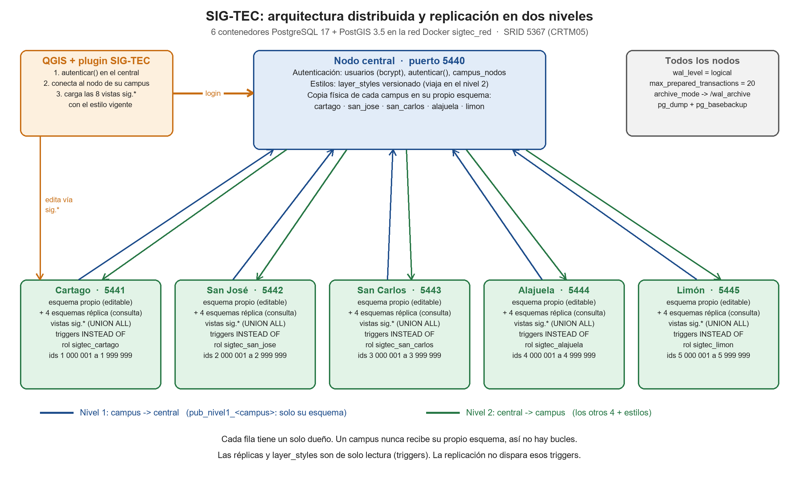
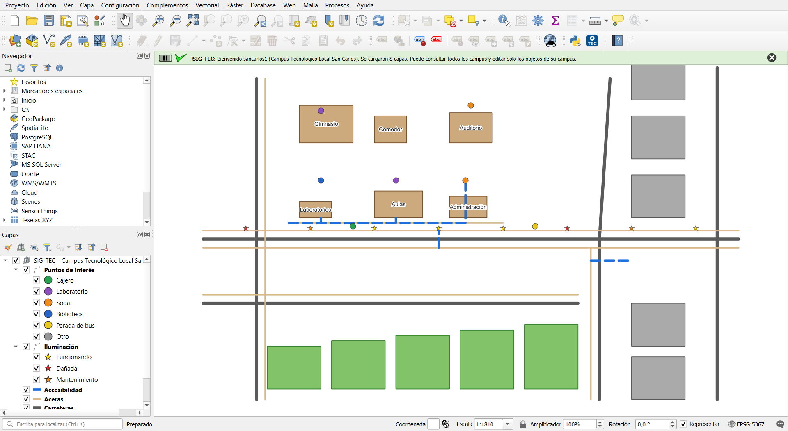

# SIG-TEC

**Sistema Distribuido de Gestión de Información Geográfica de los Campus del Tecnológico de Costa Rica**

Tercer Proyecto · Bases de Datos II · Instituto Tecnológico de Costa Rica, Sede San Carlos
Danny Jesús González Molina · Francisco Javier Castillo Duarte · Dylan Yoel Méndez Zamora
Profesor: Msc. Leonardo Víquez Acuña

---

## Tabla de contenidos

1. [¿Qué es SIG-TEC?](#1-qué-es-sig-tec)
2. [Requisitos](#2-requisitos)
3. [Instalación paso a paso](#3-instalación-paso-a-paso)
   - [Paso 1. Verificar los programas](#paso-1-verificar-los-programas)
   - [Paso 2. Descargar el proyecto](#paso-2-descargar-el-proyecto)
   - [Paso 3. Instalar la librería de Python](#paso-3-instalar-la-librería-de-python)
   - [Paso 4. Encender Docker Desktop](#paso-4-encender-docker-desktop)
   - [Paso 5. Levantar el sistema](#paso-5-levantar-el-sistema)
   - [Paso 6. Comprobar que todo funciona](#paso-6-comprobar-que-todo-funciona)
4. [Pruebas automáticas](#4-pruebas-automáticas)
5. [Uso desde QGIS (plugin SIG-TEC)](#5-uso-desde-qgis-plugin-sig-tec)
6. [Demostraciones](#6-demostraciones)
7. [Apagar y volver a empezar](#7-apagar-y-volver-a-empezar)
8. [Solución de problemas](#8-solución-de-problemas)
9. [Cómo está construido](#9-cómo-está-construido)
10. [Estructura del proyecto](#10-estructura-del-proyecto)
11. [Documentación](#11-documentación)

---

## 1. ¿Qué es SIG-TEC?

SIG-TEC administra la información geográfica de los cinco campus del TEC: Cartago, San José, San Carlos, Alajuela y Limón. Guarda edificios, carreteras, aceras, parqueos, zonas verdes, puntos de interés, iluminación y accesibilidad.

- Hay **seis servidores** PostgreSQL con PostGIS. Hay uno por campus y un **nodo central** que se encarga de la autenticación y de la coordinación.
- **Cada campus edita solo sus propios datos**, pero **todos pueden consultar la información de todos**.
- Los datos viajan entre servidores con **replicación lógica en dos niveles**:
  - **Nivel 1.** Cada campus envía sus datos al nodo central.
  - **Nivel 2.** El nodo central reparte a cada campus los datos de los otros cuatro.
- **QGIS** es la interfaz de trabajo. Un **plugin** propio autentica al usuario y carga las capas de su campus.
- Los seis servidores corren en **contenedores de Docker** en una sola computadora. Se levantan con un solo comando.



---

## 2. Requisitos

Instale estos programas antes de empezar. Todos son gratuitos.

| Programa | Para qué se usa | Dónde descargarlo |
|---|---|---|
| **Docker Desktop** | Ejecuta los seis servidores de base de datos | <https://www.docker.com/products/docker-desktop/> |
| **Python 3.10 o superior** | Ejecuta los scripts de instalación, pruebas y demostraciones | <https://www.python.org/downloads/> |
| **Git** *(opcional)* | Descarga el proyecto. También se puede bajar como ZIP | <https://git-scm.com/downloads> |
| **QGIS 3.22 o superior** *(para el plugin)* | Interfaz geográfica. Se recomienda la versión **LTR** | <https://qgis.org/download/> |

> **Importante al instalar Python en Windows:** en la primera pantalla del instalador marque la casilla **"Add python.exe to PATH"**.

El proyecto fue probado en **Windows 11** con Docker Desktop, Python 3.12 y QGIS 3.44 LTR. Usa unos **2 GB** de disco y los puertos **5440 a 5445**.

---

## 3. Instalación paso a paso

Todos los comandos se escriben en una terminal: **PowerShell** en Windows, o **Terminal** en macOS y Linux. Escriba cada comando, presione **Enter** y espere a que termine antes de escribir el siguiente.

### Paso 1. Verificar los programas

Escriba estos tres comandos. Cada uno debe mostrar un número de versión.

```powershell
docker --version
python --version
git --version
```

Si alguno dice que el comando no se reconoce, ese programa no está instalado o no quedó en el PATH. Vea la [sección 8](#8-solución-de-problemas).

> En macOS y Linux puede que el comando sea `python3` en lugar de `python`. Use `python3` en todos los pasos.

### Paso 2. Descargar el proyecto

**Opción A, con Git:**

```powershell
git clone https://github.com/Danny7w7-coder/proyecto3Bases2.git sig-tec
cd sig-tec
```

**Opción B, sin Git:**

1. En la página del repositorio, haga clic en el botón verde **Code → Download ZIP**.
2. Descomprima el archivo.
3. En la terminal, entre a la carpeta descomprimida. Por ejemplo:
   ```powershell
   cd "$HOME\Downloads\proyecto3Bases2-main"
   ```

Desde aquí, **todos los comandos se ejecutan dentro de esa carpeta**.

### Paso 3. Instalar la librería de Python

El proyecto usa una sola librería, `psycopg2`, para conectarse a PostgreSQL.

```powershell
python -m pip install -r requirements.txt
```

Debe terminar con un mensaje como `Successfully installed psycopg2-binary...` o `Requirement already satisfied`.

### Paso 4. Encender Docker Desktop

1. Abra **Docker Desktop** desde el menú Inicio.
2. Espere a que abajo a la izquierda diga **Engine running**. Puede tardar un minuto.

Deje Docker Desktop abierto mientras use el sistema.

### Paso 5. Levantar el sistema

```powershell
python scripts/init_all.py --reset
```

Este comando hace todo:

1. Crea el archivo `.env` con **contraseñas aleatorias**. El repositorio no guarda contraseñas.
2. Descarga la imagen de PostgreSQL + PostGIS. Solo la primera vez, pesa varios cientos de MB.
3. Levanta los seis contenedores.
4. Crea las tablas, vistas, funciones y usuarios.
5. Carga datos de ejemplo de los cinco campus.
6. Configura la replicación de los dos niveles.
7. Publica los estilos de QGIS.

**Tiempo:** unos 2 minutos, y más la primera vez por la descarga. Al final debe aparecer:

```
Listo. Para ver el estado: python scripts/estado_nodos.py
```

> La opción `--reset` borra todo y empieza de cero. Sin ella, el comando solo completa lo que falte y no borra datos.

### Paso 6. Comprobar que todo funciona

```powershell
python scripts/estado_nodos.py
```

Debe mostrar una tabla con los seis nodos (`central`, `cartago`, `san_jose`, `san_carlos`, `alajuela`, `limon`), todos con estado **OK**. Al final dice:

```
TODO OK
```

Listo, el sistema está funcionando.

---

## 4. Pruebas automáticas

```powershell
python scripts/correr_pruebas.py
```

- Ejecuta **54 pruebas** y muestra **OK** o **FALLO** en cada una. Tarda unos **4 minutos**.
- Al final debe decir: `Resultado: 54 OK, 0 FALLO`.
- Algunas pruebas apagan y restauran nodos a propósito (respaldos y recuperación). Es normal.
- Si QGIS no está instalado, la prueba del plugin dentro de QGIS aparece como **OMITIDA** y no cuenta como fallo.

| Grupo de pruebas | Qué revisa |
|---|---|
| Estructura | Los 6 nodos, las 8 capas en cada esquema, el sistema de coordenadas, los datos de ejemplo y la protección de las copias |
| Replicación | Que un cambio llegue al central y a los otros campus, y que un `ROLLBACK` no se replique |
| Vistas | Que un campus edite lo suyo y no pueda editar lo de otro |
| Nodo central | Inicio de sesión, contraseñas cifradas y estilos |
| Transacciones | Commit en dos fases y modo síncrono |
| Plugin | La lógica del plugin y el plugin funcionando dentro de QGIS |
| Respaldos | Respaldos lógico y físico, PITR y recuperación de un nodo perdido |

---

## 5. Uso desde QGIS (plugin SIG-TEC)

**Requisito:** el sistema debe estar levantado ([Paso 5](#paso-5-levantar-el-sistema)).

### 5.1 Instalar el plugin

1. Descargue **`sigtec.zip`** de la sección [**Releases**](../../releases/latest) del repositorio. No lo descomprima.
2. Abra **QGIS**.
3. Menú **Complementos → Administrar e instalar complementos…**
4. A la izquierda, elija **Instalar a partir de ZIP**.
5. Con el botón **…**, seleccione `sigtec.zip` y haga clic en **Instalar complemento**.
6. Cierre la ventana. En la barra de herramientas aparece un botón azul con la palabra **TEC**.

### 5.2 Ingresar

1. Haga clic en el botón **TEC**.
2. Escriba un usuario de la tabla de abajo y su contraseña. Haga clic en **Ingresar**.
3. El plugin carga automáticamente las **8 capas** del campus del usuario, con su simbología, y acerca el mapa al campus.

| Usuario | Campus | Contraseña |
|---|---|---|
| `cartago1`, `cartago2` | Cartago | `tec2026` |
| `sanjose1` | San José | `tec2026` |
| `sancarlos1`, `sancarlos2` | San Carlos | `tec2026` |
| `alajuela1` | Alajuela | `tec2026` |
| `limon1` | Limón | `tec2026` |
| `inactivo1` | San Carlos. Está **desactivado** para probar que se rechaza | `tec2026` |

| Ventana de ingreso | Capas cargadas |
|---|---|
|  |  |



### 5.3 Editar

- Cada usuario puede **consultar los cinco campus**: al alejar el mapa se ven todos.
- Solo puede **editar los objetos de su campus**. Si intenta modificar un objeto de otro campus, la base de datos lo rechaza y QGIS muestra el motivo:


La guía completa del plugin, con una prueba de 11 pasos, está en [docs/INSTALAR_PLUGIN.md](docs/INSTALAR_PLUGIN.md).

---

## 6. Demostraciones

Estos comandos muestran cada parte del proyecto. Se recomienda ejecutarlos **en este orden**, con el sistema recién levantado.

| # | Comando | Qué muestra | Tiempo |
|---|---|---|---|
| 1 | `python scripts/estado_nodos.py` | Los 6 nodos, sus versiones y su configuración | 2 s |
| 2 | `python scripts/replicacion.py estado` | Las publicaciones y suscripciones de los dos niveles de replicación | 2 s |
| 3 | `python scripts/verificar_consistencia.py` | Compara las 40 capas en los 6 nodos y muestra el retraso de la replicación | 5 s |
| 4 | `python scripts/demo_2pc.py` | **Commit en dos fases** entre el central y San Carlos: éxito, falla y caída del coordinador | 5 s |
| 5 | `python scripts/modo_sincrono.py demo` | Replicación **asíncrona contra síncrona**. *Apaga y enciende el nodo central* | 40 s |
| 6 | `python scripts/escenarios.py a` | **Escenario A:** borrado por error en San Carlos y recuperación a un instante exacto (PITR) | 20 s |
| 7 | `python scripts/escenarios.py b fisico` | **Escenario B:** se pierde el nodo de Limón y se restaura con el respaldo físico | 20 s |
| 8 | `python scripts/escenarios.py b desde_central` | **Escenario B:** se pierde Limón y se recupera desde el central con replicación lógica | 30 s |

Explicación detallada:

- Replicación y transacciones: [docs/TRANSACCIONES.md](docs/TRANSACCIONES.md)
- Respaldos y recuperación: [docs/RESPALDOS.md](docs/RESPALDOS.md)

<details>
<summary><b>Otros comandos útiles</b> (clic para ver)</summary>

| Comando | Qué hace |
|---|---|
| `python scripts/respaldos.py logico todos` | Respaldo lógico (`pg_dump`) de cada nodo |
| `python scripts/respaldos.py fisico todos` | Respaldo físico (`pg_basebackup`) de cada nodo |
| `python scripts/respaldos.py verificar cartago` | Restaura el último respaldo lógico en una base aparte y compara |
| `python scripts/respaldos.py listar` | Lista los respaldos guardados y el estado del WAL |
| `python scripts/generar_estilos.py listar` | Versiones de los estilos de QGIS |
| `python scripts/generar_estilos.py nueva edificios 70,130,200` | Crea una versión nueva del estilo de una capa |
| `python scripts/generar_estilos.py activar edificios 1` | Vuelve a una versión anterior del estilo |
| `python scripts/cargar_datos.py --forzar` | Vuelve a cargar los datos de ejemplo |
| `python scripts/replicacion.py reactivar` | Relanza la replicación si quedó detenida |

</details>

---

## 7. Apagar y volver a empezar

| Quiero… | Comando |
|---|---|
| Apagar los servidores **sin perder datos** | `docker compose stop` |
| Encenderlos otra vez | `python scripts/init_all.py` |
| Borrar todo y empezar de cero | `python scripts/init_all.py --reset` |
| Apagar y **eliminar todo** (contenedores y datos) | `docker compose down -v` |

---

## 8. Solución de problemas

| Problema | Solución |
|---|---|
| `failed to connect to the docker API` o `Cannot connect to the Docker daemon` | Docker Desktop no está encendido. Ábralo y espere a que diga **Engine running** ([Paso 4](#paso-4-encender-docker-desktop)). |
| `"python" no se reconoce como un comando` | Python no quedó en el PATH. Reinstálelo marcando **"Add python.exe to PATH"**, o use `py` en lugar de `python`. |
| `ModuleNotFoundError: No module named 'psycopg2'` | Falta el [Paso 3](#paso-3-instalar-la-librería-de-python). |
| `port is already allocated` o `Bind for 0.0.0.0:5440 failed` | Otro programa usa esos puertos. Cambie `PORT_CENTRAL`… `PORT_LIMON` en el archivo `.env` y ejecute `python scripts/init_all.py --reset`. |
| `estado_nodos.py` muestra un nodo **CAIDO** | Ejecute `python scripts/init_all.py`. Si persiste, use `--reset`. |
| La replicación no avanza (`verificar_consistencia.py` dice **DIFERENTE**) | Ejecute `python scripts/replicacion.py reactivar` y espere unos segundos. |
| El plugin dice "No se pudo conectar" | El sistema no está levantado o Docker está apagado. Haga los pasos 4 y 5. |
| El botón **TEC** no aparece en QGIS | **Complementos → Administrar e instalar complementos → Instalados** y marque **SIG-TEC**. |

---

## 9. Cómo está construido

| Componente | Descripción | Archivo principal |
|---|---|---|
| **Modelo de datos** | Cada nodo tiene 5 esquemas (uno por campus) con 8 capas. Sistema de coordenadas institucional EPSG:5367 (CRTM05). Cada objeto tiene un id global y el campus al que pertenece | [sql/comun/10_capas_por_esquema.sql](sql/comun/10_capas_por_esquema.sql) |
| **Replicación** | Nivel 1: campus → central. Nivel 2: central → los otros 4 campus, más los estilos | [scripts/replicacion.py](scripts/replicacion.py) |
| **Vistas distribuidas** | Cada capa de QGIS es una vista que une los 5 esquemas. Los disparadores `INSTEAD OF` deciden si una edición se permite | [sql/campus/31_vistas.sql](sql/campus/31_vistas.sql) |
| **Autenticación** | Usuarios con contraseñas cifradas (bcrypt) en el nodo central. El plugin solo puede llamar a la función `autenticar()` | [sql/central/21_autenticacion.sql](sql/central/21_autenticacion.sql) |
| **Estilos** | Tabla `layer_styles` con versiones, guardada en el central y replicada a los campus | [scripts/generar_estilos.py](scripts/generar_estilos.py) |
| **Transacciones distribuidas** | Atomicidad de la replicación, modo síncrono y commit en dos fases | [docs/TRANSACCIONES.md](docs/TRANSACCIONES.md) |
| **Respaldo y recuperación** | `pg_dump`, `pg_basebackup`, WAL archivado, PITR y recuperación de un nodo | [docs/RESPALDOS.md](docs/RESPALDOS.md) |
| **Plugin de QGIS** | Ventana de ingreso, carga automática de capas y estilos, y avisos de edición rechazada | [plugin/sigtec/](plugin/sigtec/) |

### Servidores

| Nodo | Función | Puerto |
|---|---|---|
| `central` | Autenticación, estilos y copia de los 5 campus | 5440 |
| `cartago` | Campus Tecnológico Central Cartago | 5441 |
| `san_jose` | Campus Tecnológico Local San José | 5442 |
| `san_carlos` | Campus Tecnológico Local San Carlos | 5443 |
| `alajuela` | Campus Tecnológico Local Alajuela | 5444 |
| `limon` | Campus Tecnológico Local Limón | 5445 |

Para entrar a la base de un nodo desde la terminal: `docker exec -it sigtec_cartago psql -U postgres -d sigtec`. Para salir, escriba `\q`.

---

## 10. Estructura del proyecto

```
sig-tec/
├── README.md               esta guía
├── docker-compose.yml      los 6 servidores
├── .env.example            plantilla de configuración (el .env real se crea solo)
├── requirements.txt        librería de Python necesaria
├── sql/                    scripts de base de datos, en orden
│   ├── central/            solo para el nodo central
│   ├── campus/             para los 5 campus
│   └── comun/              para los 6 nodos
├── scripts/                instalación, demostraciones, respaldos y recuperación
├── plugin/sigtec/          plugin de QGIS
├── tests/                  pruebas automáticas
└── docs/                   documentación, guías y figuras
```

---

## 11. Documentación

| Documento | Contenido |
|---|---|
| [docs/Documentacion_Proyecto3.pdf](docs/Documentacion_Proyecto3.pdf) | Documentación completa del proyecto (también en [Word](docs/Documentacion_Proyecto3.docx)) |
| [docs/INSTALAR_PLUGIN.md](docs/INSTALAR_PLUGIN.md) | Instalación y prueba del plugin de QGIS |
| [docs/TRANSACCIONES.md](docs/TRANSACCIONES.md) | Replicación en dos niveles y transacciones distribuidas |
| [docs/RESPALDOS.md](docs/RESPALDOS.md) | Respaldos, recuperación a un instante (PITR) y escenarios de falla |
