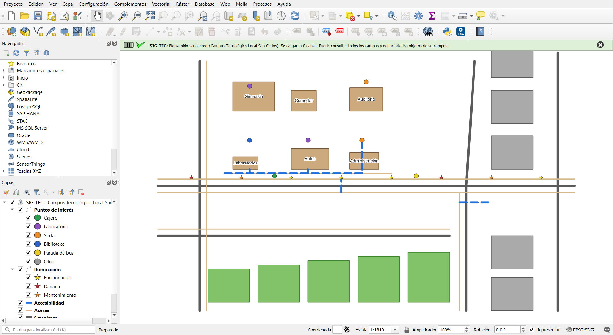
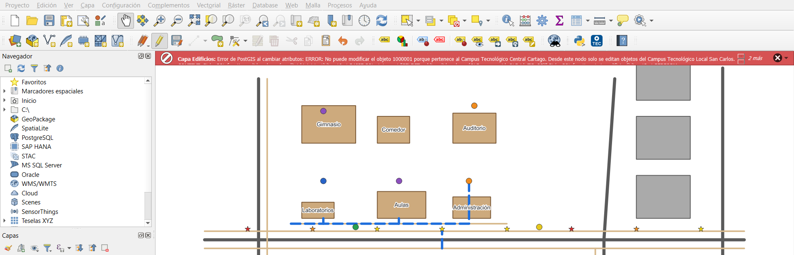

# Plugin SIG-TEC para QGIS

Guía para instalar el plugin, ingresar al sistema y probar que todo funciona.

[← Volver al README](../README.md)

---

## Tabla de contenidos

1. [¿Qué hace el plugin?](#1-qué-hace-el-plugin)
2. [Requisitos](#2-requisitos)
3. [Instalar el plugin](#3-instalar-el-plugin)
4. [Ingresar al sistema](#4-ingresar-al-sistema)
5. [Prueba completa paso a paso](#5-prueba-completa-paso-a-paso)
6. [Solución de problemas](#6-solución-de-problemas)
7. [Pruebas automáticas del plugin](#7-pruebas-automáticas-del-plugin)
8. [Información técnica](#8-información-técnica)

---

## 1. ¿Qué hace el plugin?

1. Muestra una **ventana de ingreso** con usuario, contraseña y el botón **Ingresar**.
2. **Verifica el usuario** contra el nodo central de SIG-TEC.
3. Averigua **a qué campus pertenece** el usuario y se conecta al servidor de ese campus.
4. **Agrega automáticamente las 8 capas** al proyecto de QGIS, con su simbología, y acerca el mapa al campus.
5. Si el usuario intenta **editar un objeto de otro campus**, muestra el motivo por el que la base de datos lo rechazó.

---

## 2. Requisitos

| Requisito | Cómo verificarlo |
|---|---|
| **QGIS 3.22 o superior**. Se recomienda la versión LTR | Menú **Ayuda → Acerca de** |
| **El sistema SIG-TEC levantado** | En la terminal, dentro de la carpeta del proyecto: `python scripts/estado_nodos.py` debe terminar con `TODO OK`. Si no, siga el [README, sección 3](../README.md#3-instalación-paso-a-paso) |
| **El archivo `sigtec.zip`** | Descárguelo de la sección [Releases](../../../releases/latest) del repositorio, o genérelo con `python scripts/empaquetar_plugin.py` (queda en `dist/sigtec.zip`) |

No hace falta instalar nada más en QGIS.

---

## 3. Instalar el plugin

1. Abra **QGIS**.
2. Vaya al menú **Complementos → Administrar e instalar complementos…**
3. En la columna izquierda, haga clic en **Instalar a partir de ZIP**.
4. Haga clic en el botón **…** y seleccione el archivo `sigtec.zip`. **No lo descomprima.**
5. Haga clic en **Instalar complemento**. Si QGIS pregunta si confía en el complemento, responda que sí.
6. Cierre la ventana de complementos.

**Resultado esperado:** en la barra de herramientas aparece un botón azul con un marcador y la palabra **TEC**. También aparece el menú **Complementos → SIG-TEC**.

> **Para actualizar el plugin** a una versión nueva, repita estos pasos con el `sigtec.zip` nuevo. Si QGIS no toma el cambio, ciérrelo y ábralo otra vez.

---

## 4. Ingresar al sistema

1. Haga clic en el botón **TEC**.
2. Escriba un usuario y su contraseña, y haga clic en **Ingresar**.

| Usuario | Campus | Contraseña |
|---|---|---|
| `cartago1`, `cartago2` | Cartago | `tec2026` |
| `sanjose1` | San José | `tec2026` |
| `sancarlos1`, `sancarlos2` | San Carlos | `tec2026` |
| `alajuela1` | Alajuela | `tec2026` |
| `limon1` | Limón | `tec2026` |
| `inactivo1` | San Carlos. Está **desactivado** para probar que se rechaza | `tec2026` |

**Resultado esperado:**

- La ventana se cierra.
- En el panel **Capas** aparece el grupo **SIG-TEC – (nombre del campus)** con 8 capas: puntos de interés, iluminación, accesibilidad, aceras, carreteras, edificios, parqueos y zonas verdes.
- El mapa muestra el campus del usuario.
- Arriba aparece un mensaje verde de bienvenida.



---

## 5. Prueba completa paso a paso

Esta prueba recorre todo lo que hace el plugin. Toma unos **5 minutos**. Haga los pasos en orden.

| # | Qué hacer | Qué debe pasar |
|---|---|---|
| 1 | Clic en el botón **TEC** | Se abre la ventana **SIG-TEC – Ingreso** con usuario, contraseña e **Ingresar** |
| 2 | Usuario `sancarlos1`, contraseña `mala` → **Ingresar** | Mensaje rojo: *Usuario o contraseña incorrectos.* La ventana sigue abierta |
| 3 | Usuario `inactivo1`, contraseña `tec2026` → **Ingresar** | Mensaje rojo: *El usuario inactivo1 está inactivo.* |
| 4 | Usuario `sancarlos1`, contraseña `tec2026` → **Ingresar** | Se carga el grupo del campus San Carlos con 8 capas, el mapa se acerca al campus y aparece el mensaje verde de bienvenida |
| 5 | Observe el mapa | Edificios en color café con su nombre, zonas verdes, parqueos grises, calles, aceras, rampas en azul punteado, y puntos de interés y luminarias con un color según su tipo o estado |
| 6 | Aleje el mapa con la **rueda del mouse** | Se ven los datos de los **cinco campus** en las mismas capas |
| 7 | Clic derecho en la capa **Edificios** → **Abrir tabla de atributos** | La tabla muestra edificios de los 5 campus. La columna `campus_id` indica el dueño (1 = Cartago … 5 = Limón) |
| 8 | En la tabla, clic en el **lápiz** (*Conmutar el modo de edición*). En la fila **Laboratorios** (`campus_id` 3), doble clic en la celda **pisos**, escriba `5`, presione **Enter** y haga clic en el **disquete** (*Guardar ediciones*) | Se guarda sin errores, porque el edificio es de San Carlos |
| 9 | En la fila **Biblioteca** (`campus_id` 1), cambie **pisos** a `9` y haga clic en el **disquete** | **No se guarda.** Aparece una barra roja: *No puede modificar el objeto … porque pertenece al Campus Tecnológico Central Cartago…* |
| 10 | Haga clic en el **lápiz** para salir de edición y elija **Descartar** | Se deshace el cambio rechazado |
| 11 | Clic en **TEC** e ingrese con `cartago1` / `tec2026` | El grupo cambia al campus Cartago, sin duplicar capas. En Edificios, Laboratorios de San Carlos muestra los **5 pisos** del paso 8: el cambio llegó por replicación |



> Al terminar, para devolver los datos de ejemplo a su estado original, ejecute en la terminal: `python scripts/cargar_datos.py --forzar`

---

## 6. Solución de problemas

| Problema | Solución |
|---|---|
| El botón **TEC** no aparece | **Complementos → Administrar e instalar complementos → Instalados** y marque **SIG-TEC** |
| *No se pudo conectar a localhost:5440* | El sistema no está levantado. Abra Docker Desktop y ejecute `python scripts/init_all.py` |
| Ingresa, pero no aparece ninguna capa | Ejecute `python scripts/estado_nodos.py`. Si un nodo está **CAIDO**, ejecute `python scripts/init_all.py` |
| El mapa queda en blanco | Clic derecho en la capa **Edificios → Zoom a la capa**, y acerque con la rueda del mouse |
| Cambió los puertos en `.env` | Edite también `config.ini` dentro de la carpeta del plugin (puerto del nodo central) y vuelva a generar el zip con `python scripts/empaquetar_plugin.py` |
| Otro error | Revise **Ver → Paneles → Registro de mensajes**, pestañas *SIG-TEC*, *PostGIS* y *Python warning* |

---

## 7. Pruebas automáticas del plugin

El plugin tiene tres niveles de pruebas automáticas.

| Nivel | Cómo se ejecuta | Qué prueba |
|---|---|---|
| **Lógica** (sin QGIS) | `python scripts/correr_pruebas.py plugin_logica` | Configuración, ingreso correcto e incorrecto, servidor apagado, estilos, mensajes de error y protección contra inyección SQL |
| **Dentro de QGIS** (sin abrir la ventana) | `python scripts/correr_pruebas.py plugin_qgis` | 12 pruebas: carga del plugin, ingreso, 8 capas con su sistema de coordenadas, estilos, mapa en el campus, edición propia y ajena, alta y baja de un punto, cambio de usuario |
| **En la ventana real de QGIS** | Ver abajo | Los pasos 1 a 10 de la sección 5, con la ventana, la barra de mensajes y el mapa reales. Guarda una captura en cada paso |

**Prueba en la ventana real** (requiere tener el plugin instalado, sección 3):

```powershell
$env:SIGTEC_CAPTURAS = "$HOME\Desktop\capturas_sigtec"
& "C:\Program Files\QGIS 3.44.15\bin\qgis-ltr.bat" --nologo --code "$PWD\tests\qgis\prueba_ventana_qgis.py"
```

Ajuste la ruta de QGIS a la versión instalada. QGIS se abre, hace los pasos solo y se cierra. El resultado queda en `resultado.txt`, dentro de la carpeta de capturas. Al terminar, ejecute `python scripts/cargar_datos.py --forzar` para devolver los datos de ejemplo a su estado original.

---

## 8. Información técnica

- **Archivos del plugin** (`plugin/sigtec/`):

  | Archivo | Función |
  |---|---|
  | `logica.py` | Configuración, ingreso y lectura de estilos. No depende de QGIS |
  | `capas.py` | Arma cada capa con `QgsDataSourceUri`: esquema `sig`, clave `id`, geometría `geom`, SRID 5367 |
  | `dialogo_login.py` | Ventana de ingreso |
  | `plugin.py` | Botón, menú y proceso completo de ingreso |
  | `conexion_qgis.py` | Conexión de respaldo si el Python de QGIS no tiene `psycopg2` |
  | `config.ini` | Dirección del nodo central (`localhost:5440`) |

- **Seguridad:** el plugin entra al nodo central con el usuario `sigtec_login`, que **solo puede ejecutar la función `autenticar()`** y no puede leer ninguna tabla. Los datos para conectarse al servidor del campus los entrega el central únicamente después de un ingreso correcto.
- **Compatibilidad:** probado en QGIS 3.44 LTR (Windows). Preparado para QGIS 4.
